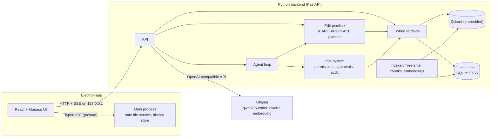

# LyxiaIDE

**A local-first, AI-native code editor** (think Cursor, running entirely on your machine). It understands a whole repository, answers questions with cited sources, edits code through a reviewable diff, runs tools under a permission system, and can work autonomously on multi-step tasks.

Built as a learning and portfolio project to explore how to put an LLM *inside* a real developer workflow: retrieval, safe editing, tool use and agent control. All models run locally through [Ollama](https://ollama.com); no code leaves your machine.

> **Status: working prototype, not production software.** See [Status](#status) and [Limitations](#limitations) for what is verified and what is not.


## Features

**Editor** (Electron + React + Monaco): file explorer, tabs, unsaved-change tracking, save, remembered workspace.

**Repository understanding**
- Scanner: languages, frameworks, dependencies, entry points, tests; secrets are counted but never read or listed.
- Tree-sitter parsing (Python, JavaScript, TypeScript, TSX) into functions, classes, methods, imports and exports.
- Import graph with **impact analysis** ("what is affected if I change this file?"), cycle detection, and support for namespace packages.

**Retrieval**
- AST-aware chunking: code is split along function and class boundaries, with comments attached.
- Embeddings (Qwen3-Embedding via Ollama) in an embedded **Qdrant**, plus keyword search with **SQLite FTS5 (BM25)**, merged with **Reciprocal Rank Fusion**.
- **Incremental indexing**: only chunks whose text changed are re-embedded.
- A small **evaluation harness** (hit@1, recall@5, MRR) to compare semantic, keyword and hybrid search.

**Chat**: streaming, repository-aware answers that cite `file:line` sources, aware of your active file and selection.

**AI editing**
- `Ctrl+K`: edit the current file; `Ctrl+I`: plan and edit across files (including new files).
- The model emits SEARCH/REPLACE blocks instead of rewriting files; you review a diff and accept or reject.
- Every applied change is snapshotted: **one-click rollback**, even after saving or restarting, with conflict detection if you edited the file since.

**Tools and permissions**: 12 tools (read, search, grep, semantic search, symbol lookup, git status/diff/log/show/branch, run command). Reading is automatic; **commands always ask**; destructive ones warn and are never "always allowed"; some are blocked outright. Every call is audited.

**Agent** (`Ctrl+J`): give it a task; it investigates with read-only tools, proposes edits for your review, runs checks with your approval, reads failures, and iterates under a hard step limit, with a Stop button.

## Architecture



The backend talks to models through an OpenAI-compatible interface, so the chat and embedding models are a configuration change.

## Design decisions worth reading

- **A plain-text action protocol for the agent** (`THOUGHT / ACTION / ARGS`) instead of native function calling: small local models are unreliable at structured tool calls, so the format is forgiving to parse (fences, bullets, multi-line JSON) and errors are fed back for self-correction. Loop guards: step cap, stuck detection, a one-time "verify before finishing" reminder.
- **SEARCH/REPLACE edits** instead of whole-file rewrites: small models corrupt files they rewrite. Edits are matched exactly, then whitespace-tolerantly, ambiguity is refused, and CRLF files stay CRLF.
- **The model never gets to decide what is safe.** Paths it names are validated (no traversal, symlink escapes, secrets, build folders, binaries); commands are classified into allow / ask / destructive / blocked; secrets are stripped from child-process environments and excluded from `git diff`; Git is run with options that stop a hostile repository's config from executing programs.
- **Human in the loop by construction**: approvals are an SSE handshake that pauses the run; closing the stream withdraws the request and makes no further model calls.
- **Local-first and inspectable**: no cloud services; everything is stored under `backend/.lyxia/` and Electron's app-data folder.

## Quick start

**Prerequisites:** Node 20.19+ (22 recommended), Python 3.11+, Git, [Ollama](https://ollama.com).
Developed on Windows (commands below are PowerShell); the backend logic was also exercised on Linux.

```powershell
git clone <your-repo-url> LyxiaIDE
cd LyxiaIDE

ollama pull qwen2.5-coder:7b        # chat / editing / agent
ollama pull qwen3-embedding:0.6b    # embeddings

# 1) backend
cd backend
python -m venv .venv
.venv\Scripts\Activate.ps1          # macOS/Linux: source .venv/bin/activate
python -m pip install -r requirements.txt
python -m uvicorn app.main:app --port 8765 --reload

# 2) frontend dev server (new terminal)
cd frontend
npm install
npm run dev

# 3) desktop window (third terminal)
cd frontend
npx electron .
```

First use: `Ctrl+O` to open a project, click **Index now** in the chat panel, then ask questions. Settings are environment variables (see `backend/.env.example`).

| Shortcut | Action |
|---|---|
| `Ctrl+O` / `Ctrl+S` | Open folder / save |
| `Ctrl+K` | AI edit of the current file |
| `Ctrl+I` | AI edit across files |
| `Ctrl+J` | Autonomous agent |
| Status bar | AI history (rollback), Tools (permissions, audit) |

## Project layout

```
frontend/
  electron/        main process: safe file service, history store, preload bridge
  src/             React UI: editor, explorer, chat, diff review, history, tools, agent panels
backend/
  app/
    api/           FastAPI routes (chat, repo, index, eval, edit, tools, agent)
    repo/ parsing/ graph/      scanner, Tree-sitter parser, import graph
    indexing/      chunker, Qdrant store, FTS5 keyword index, hybrid retrieval, evaluation
    editing/       SEARCH/REPLACE engine, multi-file planner and safety gate
    tools/         tool registry, permissions, approvals, audit, shell and git tools
    agent/         action protocol, prompt, loop
  tests/           pytest suite (pure logic, no model needed)
docs/              manual test checklist
```

## Testing

```powershell
cd backend
python -m pip install -r requirements-dev.txt
python -m pytest        # 42 tests: edit engine, agent protocol, import resolution
```

The frontend is type-checked with `tsc` (strict) as part of `npm run build`. For an end-to-end check against a real local model, follow [`docs/MANUAL_TEST.md`](docs/MANUAL_TEST.md).

Further verification scripts were used during development with scripted fake model servers: chunker invariants on real-world code (no duplicate ids, no lost lines), the import graph on FastAPI and Starlette, tool permission flows including process-tree kill on timeout, and the SSE approval handshake. They are not yet part of the repository; turning them into pytest suites is the top roadmap item.

## Status

| Area | State |
|---|---|
| Scanning, parsing, import graph, chunking, embeddings, hybrid search, streaming chat | Used against a real local model |
| AI editing, history and rollback, tools and permissions, agent | Implemented and tested with scripted models; manual verification checklist provided |

<!-- After running the evaluation (POST /eval/retrieval) and docs/MANUAL_TEST.md, add your own numbers here, e.g.:
| Mode | hit@1 | recall@5 | MRR |
|---|---|---|---|
-->

## Limitations

- **Model quality is the ceiling.** A 7B local model is unreliable at long multi-step tasks. The agent has guardrails, but expect mixed results; use a stronger model for harder tasks (`LYXIA_LLM_MODEL`).
- Approval-based safety is **not a sandbox**: approved commands run with your user rights.
- Tree-sitter support covers Python, JavaScript, TypeScript and TSX; other languages are indexed as plain text windows.
- TypeScript path aliases (`@/...`) are not resolved in the import graph.
- Embedded Qdrant suits small and medium repositories; indexing blocks the request and does not auto-refresh on file changes.
- The command tool uses `cmd.exe` and `taskkill` on Windows; those paths are lightly tested. macOS and Linux desktop use is unverified.
- The evaluation set is small and written by the author, so treat its numbers as a smoke test, not a benchmark.
- Not implemented: terminal panel, language server (LSP) features, Git UI, MCP, multi-model routing, packaging/installer.

## Roadmap

pytest suites for the remaining verification scripts, an agent benchmark (fixed tasks, automatic pass/fail, saved traces), background indexing with file watching, a model router, MCP client and server, LSP diagnostics, Electron packaging.

## How this was built

Designed and directed by the author, with an AI assistant (Claude) used as a pair-programmer for implementation and test scaffolding. Design decisions, review and verification are the author's.

## License

MIT, see [LICENSE](LICENSE). Built on Ollama, Qwen, Tree-sitter, Qdrant, Monaco and FastAPI.